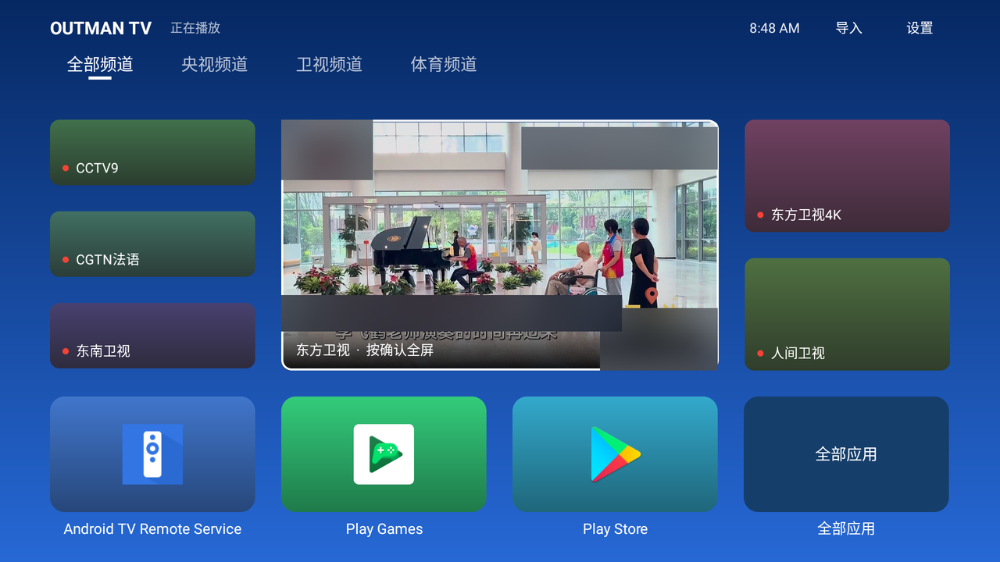
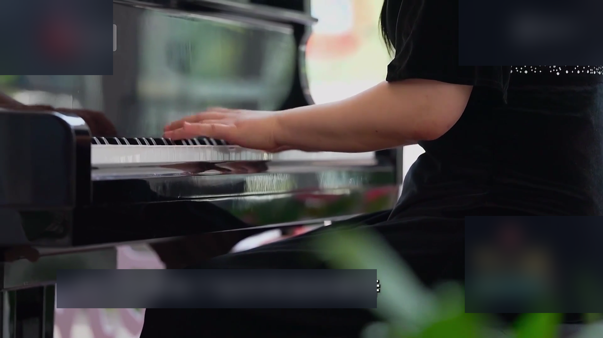
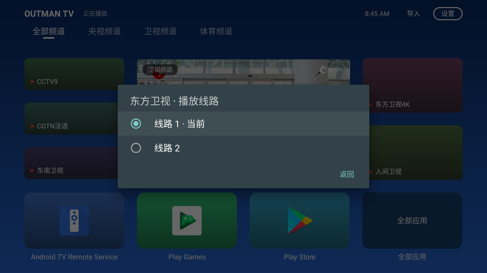
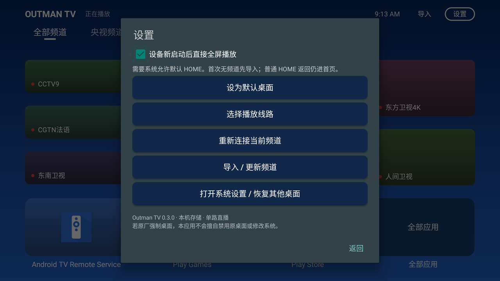

<p align="center">
  
</p>

<h1 align="center">Outman TV</h1>

<p align="center">把电视首页，换成「一打开就在放的那一屏」。</p>

<p align="center">
  <a href="https://github.com/outmanwt/outman-tv-launcher/releases"></a>
  <a href="LICENSE"></a>
  <a href="https://github.com/outmanwt/outman-tv-launcher/stargazers"></a>
  
</p>

<p align="center">
  <a href="https://github.com/outmanwt/outman-tv-launcher/releases">下载</a> ·
  <a href="docs/TESTING.md">测试说明</a> ·
  <a href="docs/ROADMAP.md">路线图</a> ·
  <a href="THIRD_PARTY_NOTICES.md">第三方许可</a>
</p>

<p align="center">
  <b>不 root · 不刷机 · 不卸载任何厂商应用 · 一条命令就能换回原桌面</b>
</p>

---

## 为什么做这个

我家电视的首页有三屏。第一屏是厂商的推荐位，第二屏是会员广告，第三屏才是我自己装的
App。想看个新闻，得先按六下遥控器，进一个 App，等它加载完，再从几百个频道里翻。

后来想明白一件很简单的事：**电视开机第一件该做的事，就是把我上次在看的那个频道放起来。**

于是有了这个东西。它不是什么大工程，就是一块自己想要的桌面：

- 顶上一行是分组，`全部 / 央视 / 卫视 / 体育` 这样横向切换；
- 中间那块最大的，是正在播的频道。遥控器确认进全屏，返回退回首页；
- 左右两列是同一组里的其它频道，一列三格、一列两格，跟着中间一起滚动；
- 底下是我自己装的应用，大卡片点一下就走，不用先回系统桌面再翻。

同一个频道可以挂好几条线路，断了一条自动换下一条。

<p align="center">
  
</p>

它没有走任何特权的路。Android 本来就有「默认桌面」这个角色，你在系统设置里选它，
它就是你家的桌面；你在系统设置里换回去，原桌面立刻回来。**卸载它就等于没装过。**

> 项目不附带直播源、订阅或任何内容凭据。频道由你导入自己的 M3U，能不能看取决于你的源。

## 它是怎么做的

### 一个播放器，从头到尾

很多电视桌面会在首页挂一个「预览」，点开再起一个播放器全屏——切换时会黑一下，
偶尔两个声音一起响。

这里始终只有一个播放器实例。预览和全屏共用同一块 `SurfaceView`，进全屏只是把周围
的界面藏起来、让画面铺满，播放器根本没重启过。所以从预览到全屏，中间没有黑帧。

### 一条频道，多条线路

免费源的通病是不稳定：今天通，明天 404。所以同一个频道在多个清单里出现时，会被合并成
**一个频道 + 多条线路**：

| 规则 | 做法 |
| --- | --- |
| 归组 | 同组同名才合并；`CCTV5` 和 `CCTV5+` 不会被当成同一个 |
| 首选 | 优先用上次真的播出画面那条线路 |
| 一轮上限 | 最多自动试 4 条，每条只试一次，不无限重试 |
| 冷却 | 失败线路 60 秒内不再自动重试 |
| 手动 | 设置里可以自己选线路，手动选会开新一轮预算 |

一轮试完还是不行，就停下来告诉你「线路尝试已停止，可手动重选」，而不是在后台无声地
反复重连。频道 ID 与线路 ID 都是对内容算的 SHA-256，重新导入、顺序变了，记住的线路也不会丢。

### 老回调不许碰新播放器

切线路、切频道、退后台，随时可能有一次迟到的错误回调从旧播放器飞过来。如果它被当成
新播放器的失败，就会莫名其妙地切台。

播放器每次重建都会推高一个代际号，所有回调先对代际和播放器身份，对不上直接丢弃；
终止失败的回调还要异步 post 一次再验一次代际。首帧拿到了、状态也 `READY` 了，才把这条
线路记成「成功」。

<p align="center">
  
</p>

### 你的源，你的设备

导入只接受你自己有权使用的 M3U——本地文件或订阅地址，存在本机，不上传。
界面上不会显示完整播放地址，选线路只给「线路 1 / 2 / 3」。

应用也不会去禁用别的包、不会阻止你退出、不会偷偷改系统设置。设置页里那行字是认真的：

> 若原厂强制桌面，本应用不会擅自禁用原桌面或修改系统。

<p align="center">
  
</p>

## 快速开始

```bash
cd src
./gradlew assembleDebug lintDebug
```

Windows 用同目录的 `gradlew.bat`。产物在 `src/app/build/outputs/apk/debug/`。

环境：JDK 17、Android SDK 34、Gradle 8.7、AGP 8.5、Kotlin 2.0、Media3 1.3.1，最低 Android 7.0（API 24）。
本地 SDK 路径用 `ANDROID_HOME` 或 `src/local.properties` 指定，后者不要提交。

装到电视上之后：

1. 打开应用，导入自己的 M3U（本地文件或订阅地址）；
2. 想让它当桌面，在设置里点「设为默认桌面」，走系统自己的选择界面；
3. 想换回去，点「打开系统设置 / 恢复其他桌面」，用系统的设置换回来。

也可以先装到 Android TV 模拟器里看看，不碰自己的电视。

### 跑策略测试

```bash
python script/run_core_tests.py CoreTest
python script/run_core_tests.py RouteTest
```

这两套是纯 Kotlin 的逻辑测试（104 项），覆盖 M3U 解析边界、启动策略、播放状态矩阵、
频道归组、线路预算与冷却。它们不需要设备，但也**不能代替**真机上的遥控器、HOME 角色和
解码验证。

## 版本状态

当前是 **0.3.0 debug 测试版**。这个版本做过什么、没做什么：

| | 状态 |
| --- | --- |
| debug 构建 / Android Lint | 通过（Lint 0 错误、16 警告，不是零问题） |
| 策略测试 104 项 | 通过 |
| Android TV 模拟器（API 30） | 首页预览、全屏、线路选择已实测通过（真实频道源） |
| 真机 / 遥控器 / 休眠 / 长时间播放 | **未验证** |
| 签名 | debug 签名，未来换签名可能需要卸载，本机数据会丢 |

模拟器的实测是本轮手工做的，不等于一张完整的回归矩阵；详细清单和待办都在
[测试说明](docs/TESTING.md) 里，没做的项目就写着没做。

## 已知限制

- 只验证过 Android TV 模拟器，真实盒子的 HOME 兼容性、遥控器键位、硬件解码都得你自己试。
- 频道是固定窗口：左边三格、右边两格，只显示当前频道相邻的 5 个；频道多了要靠上面的分组 tab 找，还没有搜索和收藏。
- 没有主题、没有台标自动抓取、没有 EPG 节目单。这些在 [路线图](docs/ROADMAP.md) 里，不在这一版。
- 播放能不能成，最终取决于你的源。源挂了不是播放器的锅，程序只能帮你换下一条。

## 许可

原创部分 [MIT](LICENSE)，Copyright (c) 2026 outmanwt。

同组同名的多线路归组思路参考了 `minyoad/mytv-android`（MIT，Copyright (c) 2020-PRESENT
yaoxieyoulei，commit `9263a658`），原文许可随 APK 一起打包在
`src/app/src/main/assets/licenses/`。`Gathin23/cleanyourtv` 只作设计参考，没有复制代码。
AndroidX / Media3 / Gradle Wrapper 的许可见 [第三方说明](THIRD_PARTY_NOTICES.md)。

截图取自 Android TV 模拟器（API 30）的实际运行画面，播放的是公开播出的电视频道；图中频道台标、节目名称与平台水印已做遮挡处理。
画面内容的权利归原权利人，本项目不附带任何频道地址或节目内容。
